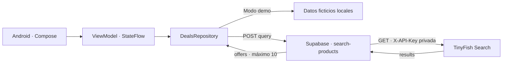
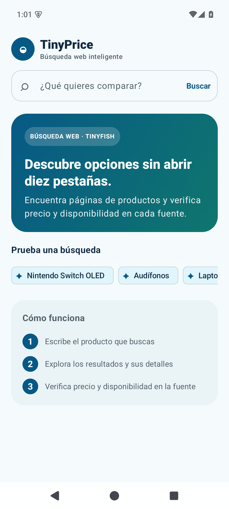
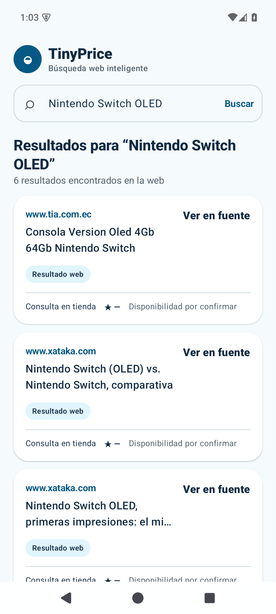
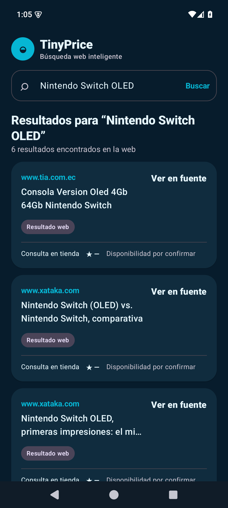

# PEA: Integración de servicio IA con Edge function de Supabase en una app móvil nativa

**TinyPrice** es una app Android nativa en Kotlin y Jetpack Compose. Busca productos con TinyFish Search a través de una Edge Function alojada en Supabase Cloud. Conserva las fuentes y muestra **Ver en fuente** cuando el proveedor no entrega un precio verificable.

Actividad basada en el [codelab del docente](https://epanchanaf.github.io/tinyprice-codelab/) y sus [ejemplos de referencia](https://github.com/epanchanaf/tinyprice-codelab/tree/main/reference). Las adaptaciones y el estado de las pruebas se documentan en [lineamientos](docs/LINEAMIENTOS.md) y [validación](docs/VALIDACION.md).

## Arquitectura



La app incorpora descubrimiento, sugerencias, búsqueda, carga, lista, estado vacío, errores con reintento, detalle y apertura del navegador. La clave de TinyFish se almacena exclusivamente en **Supabase Secrets**. La app solo conoce la URL pública del backend.

## Proyecto entregado

- Backend desplegado: `https://yprwaxdreyjemazkgjft.supabase.co/functions/v1/search-products`.
- Comprobación real: **HTTP 200, seis resultados** para Nintendo Switch OLED; recorrido verificado desde un emulador Android API 35.
- Pruebas: **10 del backend, 8 del ViewModel y 3 de Compose aprobadas**.
- APK remoto: compilar con `powershell -File scripts/build-live.ps1`. El proyecto conserva el modo demo por defecto para seguir la secuencia didáctica.
- La URL es pública y los resultados cambian con las fuentes y la disponibilidad del proveedor.

<p>
  
  
  
</p>

## Requisitos

- Android Studio, JDK 17 o superior, Android SDK API 37 y Build Tools 36.0.0.
- Gradle Wrapper 9.6.0 incluido, AGP 9.4.1, Kotlin Compose 2.2.10 y Compose BOM 2026.02.01.
- Android 6.0 / API 23 o posterior para ejecutar la app.
- Node.js 24 o superior para las herramientas y pruebas del backend.
- Cuenta de TinyFish con API key y un proyecto Supabase Cloud.

En versiones recientes de Android CLI, API 37 aparece como `platforms/android-37.0`:

```powershell
android sdk install platforms/android-37.0
android skills add android-cli --agent=codex --project=.
```

La habilidad oficial está en `.agents/skills/android-cli/`. Gemini CLI es opcional y no es una dependencia de la aplicación.

## Ejecutar la demo

Abre esta carpeta en Android Studio y deja que configure `local.properties` con tu SDK local. Ese archivo está excluido de Git. Usa el JDK incluido en Android Studio o configura `JAVA_HOME`.

```powershell
.\gradlew.bat :app:assembleDebug
.\gradlew.bat :app:testDebugUnitTest
```

Instala `app/build/outputs/apk/debug/app-debug.apk` o ejecuta **Run** desde Android Studio. Busca **Nintendo Switch OLED** para recorrer los ejemplos. Los datos y precios del modo demo son ficticios; los enlaces de demo apuntan a información del fabricante y no acreditan las ofertas ficticias.

En macOS/Linux se usa `./gradlew` en lugar de `.\gradlew.bat`.

## Configurar el backend alojado

1. Crea un proyecto Supabase, por ejemplo `tinyprice-codelab`, y copia su **Project Ref**.
2. En Supabase Dashboard → **Edge Functions → Secrets**, guarda `TINYFISH_API_KEY` con el valor de tu cuenta TinyFish. No lo pegues en Kotlin, Gradle, GitHub ni capturas.
3. Instala la CLI local y autentícate:

```powershell
npm ci
npm run supabase -- login
npm run supabase -- projects list
npm run supabase -- link --project-ref TU_PROJECT_REF
```

4. Despliega la función:

```powershell
npm run deploy -- --project-ref TU_PROJECT_REF
```

La configuración `supabase/config.toml` contiene `[functions.search-products]` y `verify_jwt = false`, como en el laboratorio. Esta variante no requiere una clave `anon`, `service_role` ni una sesión de usuario en la app. Tampoco necesita tablas.

5. Prueba el backend antes de activar Android:

```powershell
$endpoint = 'https://TU_PROJECT_REF.supabase.co/functions/v1/search-products'
Invoke-RestMethod -Uri $endpoint -Method Post -ContentType 'application/json' -Body '{"query":"Nintendo Switch OLED"}'
```

Respuesta: `{ "query": "...", "offers": [...], "searchedAt": "..." }`. Revisa las invocaciones y logs en Supabase. Un arreglo vacío es una respuesta válida; no implica ofertas verificadas.

## Conectar Android a Supabase

```powershell
.\gradlew.bat :app:assembleDebug -PuseRemoteDeals=true -PedgeRuntimeBaseUrl=https://TU_PROJECT_REF.supabase.co/functions/v1
```

La URL termina en `functions/v1`, sin `search-products`: Retrofit añade el nombre de la función. Para que **Run** use esos valores, configura las mismas propiedades de Gradle en Android Studio o en tu configuración local. El subtítulo de resultados debe indicar **encontrados en la web**.

## Pruebas

```powershell
npm test
.\gradlew.bat :app:testDebugUnitTest
.\gradlew.bat :app:connectedDebugAndroidTest
```

Los tests de Node prueban validación, contrato, URLs, errores, timeout y cuota con un proveedor simulado. Los tests del ViewModel prueban validación, éxito, error, cancelación y navegación. Los tests instrumentados requieren emulador o teléfono conectado.

Antes de la entrega real: búsqueda vacía; carga y resultados; detalle y volver; abrir fuente; segunda búsqueda; claro/oscuro; rotación; sin red y reintento. Las pruebas remotas necesitan el proyecto desplegado y una clave válida.

## Diagnóstico

| HTTP / síntoma | Comprobación |
| --- | --- |
| 400 | JSON y consulta de 2–200 caracteres |
| 401 | Verificar que se aplicó `verify_jwt = false` |
| 405 | Invocar con POST |
| 429 | Esperar un minuto |
| 502 | Proveedor, cuota, clave o conectividad; revisar logs privados |
| 503 | Configurar `TINYFISH_API_KEY` en Supabase Secrets |
| Android sigue en demo | Compilar con `useRemoteDeals=true` |

El límite de 20 solicitudes por minuto vive en memoria de cada instancia. Para distribución pública se requieren autenticación, límites compartidos y controles de gasto. La publicación en Play Console queda fuera del alcance del laboratorio.

## Privacidad y secretos

La consulta sale del dispositivo y se envía a Supabase y TinyFish; no introduzcas datos personales en ella. La implementación no persiste búsquedas en una base de datos. Los errores al cliente y los logs operativos no contienen la clave. `.gitignore` excluye secretos, rutas locales, keystores, dependencias descargadas y compilados.
